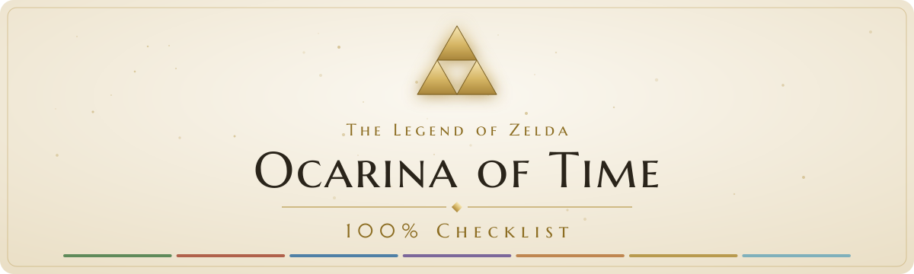
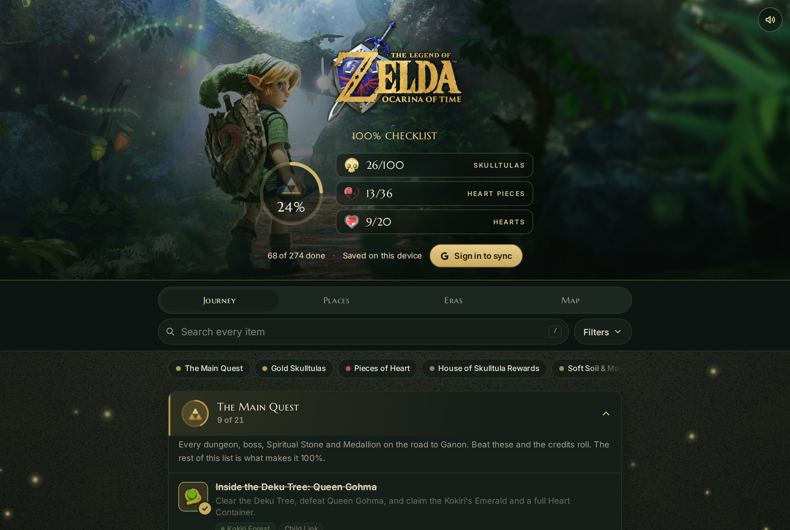
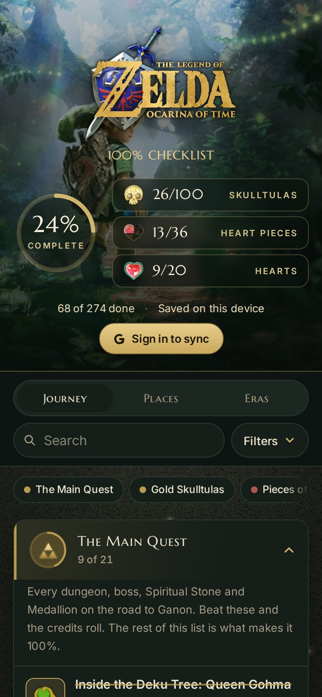
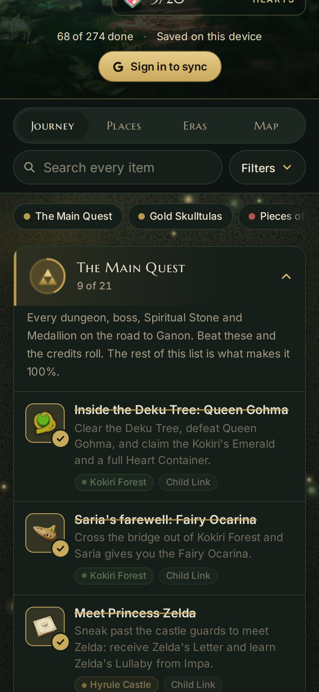
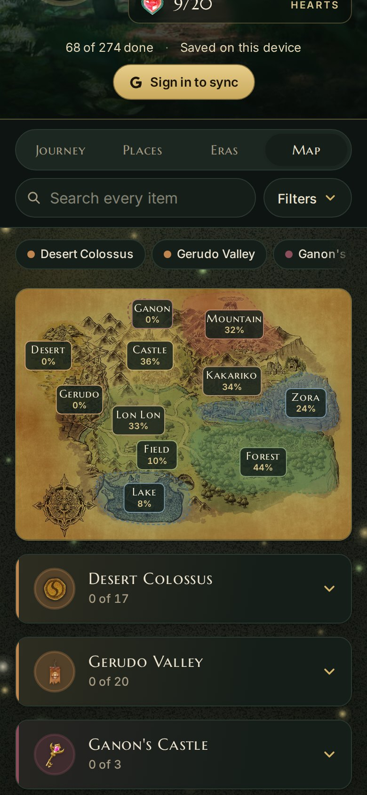
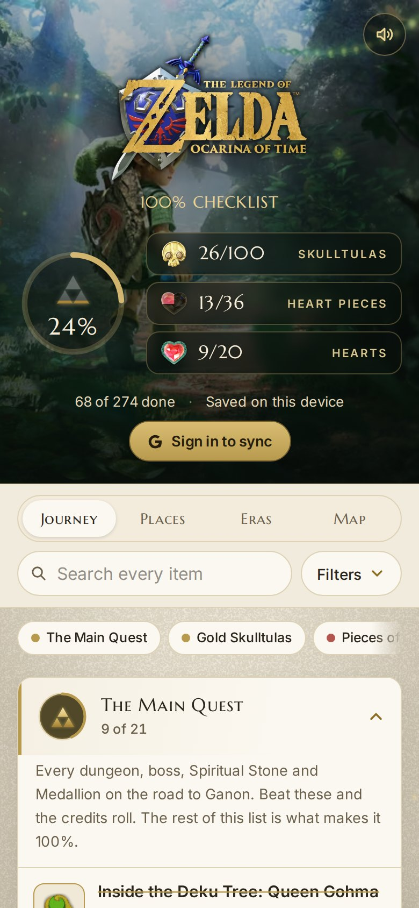

  <a href="https://oot.helv.io">
    <picture>
      <source media="(prefers-color-scheme: dark)" srcset="docs/art/banner-dark.svg">
      
    </picture>
  </a>

  <em>Every deed between Kokiri Forest and Ganon's Tower, for the Nintendo Switch 2 remake.</em>

  
  

  
  
  
  

  
  &nbsp;
  

## What it is

A checklist for **100% completion** of *Ocarina of Time* on Switch 2:
274 deeds in 17 sections. The main quest, all **100 Gold Skulltulas**
and **36 Pieces of Heart**, every upgrade, soft soil, all **5 bottles**,
songs, Great Fairies, both trading sequences, the Gerudo Proving
Grounds, merchant deals, minigame challenges and Easter eggs.

It follows the remake, not the N64 original. Where the two differ (the
fifth bottle, five Big Poes, fixed Bombchu Bowling prizes, renamed
trade items), the list says so, with sources in
[DATA-SOURCES.md](DATA-SOURCES.md).

## Features

- 🟢 **Official remake art.** Every item, place and section wears its in-game icon.
- 🔴 **Region colours.** Forest green, Death Mountain red, Zora blue, Shadow violet, desert sand, royal gold. Muted, never loud.
- 🔵 **Four views, one list.** Walk it by **Journey**, by **Places**, by **Eras** (Child and Adult Link), or on the **Map**. Every group has its own progress ring.
- 🗺️ **Nintendo's map of Hyrule.** The remake's own map, with each region tinting in its colour as you finish it and turning gold at 100%. Tap a region to jump to its list.
- 🟣 **Satisfying ticks.** A pop and a haptic tap. Finish a section and you get an item-get moment with a fanfare. The Triforce fills as your total climbs.
- 🟠 **Search everything.** Press `/` and type (try "bottle" or "Hookshot"). Pick a result to jump straight to it. Filter by status or era.
- 🎵 **Zelda's Lullaby,** very faintly, after your first tap. The speaker button, top right, mutes music and fanfare and remembers it.
- 🟡 **Share your progress** as a read-only link, or print it as a PDF.
- ⚪ **Light, dark or auto**, installable as an app, and works offline.

  
  &nbsp;
  
  &nbsp;
  

## How to use it

1. **Open [oot.helv.io](https://oot.helv.io).** No account needed. Progress saves on your device as you go.
2. **Tick things off.** Tap an item's icon. Tap a group header to fold it away.
3. **Bottles.** The remake has five. The new one is the Potion Shop's runaway bug in Kakariko.
4. **Sign in with Google** (optional) to sync between phone, Switch-side tablet and desktop. If a device and your account disagree, you choose: merge, keep the device, or keep the account.
5. **Share.** Open **More** → **Share progress** for a read-only link a friend can open.
6. **Install it.** **More** → **Install app**, or "Add to Home Screen" on iPhone. It works without signal.

## Credits

- **Art:** official Nintendo art for the Switch 2 remake, © Nintendo, from
  Zelda Wiki's [galleries for the game](https://zeldawiki.wiki/wiki/Category:Ocarina_of_Time_(Nintendo_Switch_2)_Files),
  resized and served from this site. Nothing comes from the N64 or 3DS
  versions. The gold Triforce is a custom redraw in the remake's style.
  Full list: [client/assets/official/SOURCES.md](client/assets/official/SOURCES.md).
- **Fonts:** [Marcellus SC](https://fonts.google.com/specimen/Marcellus+SC) and
  [Inter](https://rsms.me/inter/), both SIL Open Font License.
- **Data:** [DATA-SOURCES.md](DATA-SOURCES.md).

A fan-made labour of love. Not affiliated with Nintendo.

Developers: see [DEVELOPMENT.md](DEVELOPMENT.md).
